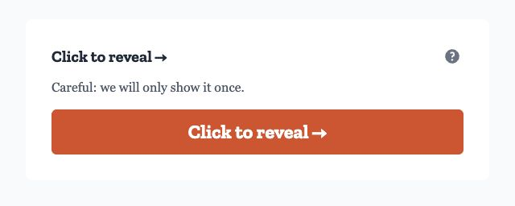
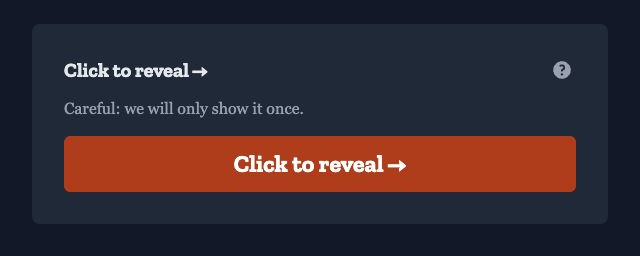
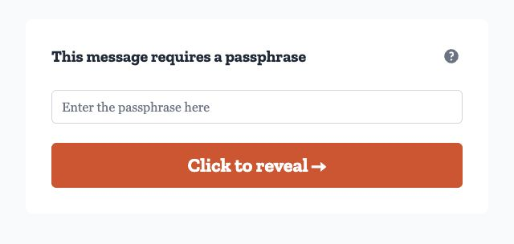
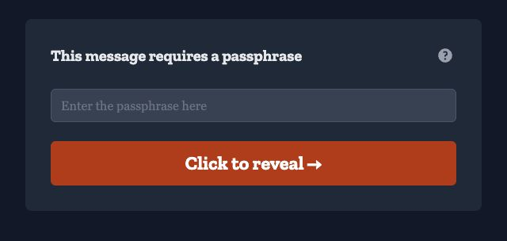
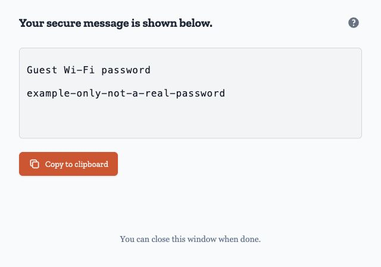
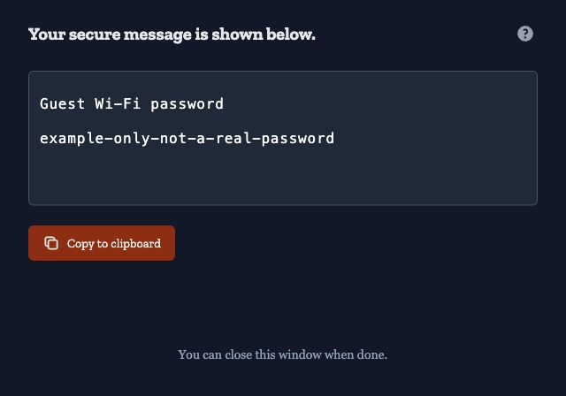
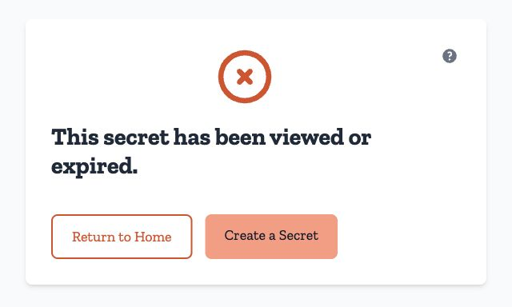
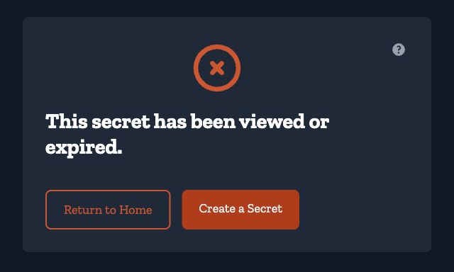

Someone sent you a link. You don't need an account, an app or a sign-in to open
it. Opening the link shows a confirmation page. Revealing the content retrieves
it once and deletes the stored secret.

This page walks through what a recipient actually experiences, in order. It is
worth reading before you send a link too — this is what the person on the other
end will meet. The screenshots show the hosted service at ca.onetimesecret.com
with a fictional guest Wi-Fi password. A custom domain may use different
branding and instructions.

## What arrives

Most links are passed along by the sender directly: a chat message, a ticket, a
phone call. Onetime Secret does not have to be involved in delivery at all.

If the sender used the built-in email option, you receive a message from
Onetime Secret with the **link only, never the content**. It names the
sender's email address in the subject line, tells you the link works only once,
and — if a passphrase is required — says so without including the passphrase
itself. The sender has to give you that separately.

Two things senders are often surprised by:

- If several addresses were entered, only the **first** one is emailed. Everyone
  else gets nothing; pass the link on yourself.
- Sending that email requires an account. Without one, you share the link
  yourself.

When the link is on a [custom domain](/en/custom-domains) that has its own
sender address configured, the email arrives from that domain instead of the
service's default address — see
[Email Sender](/en/custom-domains/email-sender).

## Before you reveal anything

Opening the link does **not** consume the secret. The confirmation page keeps
the content hidden. Under the *Click to reveal →* heading, a warning says
*Careful: we will only show it once.* Select the button below the warning when
you are ready to reveal the content.

<figure class="screenshot">

<figcaption>The content stays hidden until you select Click to reveal.</figcaption>
</figure>

Because loading the page is a plain read, a link checker or mail-security
scanner that merely fetches the URL will not destroy the secret. Only the
explicit confirmation does. (Software that goes further and actually operates
the page consumes it exactly like a person would.)

The page itself does not name the sender or say what sort of thing is inside. On
a branded domain you will see whose domain it is, but nothing more: if the
sender wants you to know anything else before you commit, they have to tell you
separately or put it in the instructions on their domain.

If you are the sender: don't open your own link to test it. The app warns you
first — *You created this secret. If you view it, the recipient will not be able
to see it.* — but if you continue, it is consumed just as if the recipient had
opened it, and they will find nothing.

## If a passphrase was set

When the sender adds a passphrase, the confirmation step asks for it, under the
heading *This message requires a passphrase*. The page will tell you that much
without revealing anything else about the secret.

<figure class="screenshot">

<figcaption>If the sender set a passphrase, enter it before revealing the content.</figcaption>
</figure>

- A wrong passphrase does not consume the secret. You get *Incorrect
  passphrase* and the secret is untouched — still there, still revealable.
- Repeated wrong guesses are rate-limited on every path that accepts a
  passphrase, so nobody can sit and grind through attempts. If you hit the
  limit, wait and try again; the correct passphrase clears the block.
- The passphrase controls **who may open** the secret. It is not the key the
  content is encrypted with — see
  [Data Protection](/en/security/data-protection).

If you don't have the passphrase, ask the sender through a different channel
than the one that carried the link. Onetime Secret never sends it for them.

## Revealing it: the part with no second chance

:::caution[There is no "view again"]
Confirming the reveal destroys the secret on the server before the page you are
looking at has even finished loading. If the browser loses that response — the
tab closes, the connection drops — the content is gone with it, and nobody, not
the sender and not Onetime Secret, can produce it a second time.
:::

Exactly one person ever receives the content. If two people confirm at the same
moment, exactly one of them receives it; the other gets nothing back, and the
next attempt shows the dead-link page.

What you see once it is revealed is the content in a read-only field with a
copy-to-clipboard action. Put it where it actually belongs — your password
manager, your configuration, wherever it is going — **before you leave the
page**.

<figure class="screenshot">

<figcaption>Copy the content before leaving this page. The password shown here is an example.</figcaption>
</figure>

## Reloading and reopening

Refreshing brings back nothing. The content is now in your browser; on the
server there is no longer anything to serve, so a reload shows the dead-link
page. The same link opened later, and the same link opened on another
device, end the same way — there is nothing left to serve to any of them.

Whatever is still on your screen is in that page, not on the server. Do not
count on getting back to it; copy it where it belongs before you leave.

There is no download, no archive and no resend. The sender cannot reopen it
either: once it is revealed, their receipt records that it happened and when,
not what it contained.

If you still need the information, ask the sender to create a new secret. See
[Sharing secrets](/en/share).

## When the link is already gone

The default message for an unavailable secret is: *This secret has been
viewed or expired.*

<figure class="screenshot">

<figcaption>After a secret has been revealed, opening the same link again shows this message.</figcaption>
</figure>

That single response covers four different situations, and it does not tell you
which one you are in:

- someone already revealed it,
- the sender destroyed it early (*burned* it),
- it reached its expiry, or
- it never existed at all.

This is deliberate, not a missing detail. Distinguishing those cases would let
anyone holding a guessed or leaked URL learn something about secrets they were
never given.

A genuine network or loading failure is shown differently, with a retryable
message — so a dead-link page really does mean the secret is not there.
[When a link doesn't work](/en/share/when-a-link-doesnt-work) walks through the
causes and what to do about each.

## What a custom domain changes

When a sender uses a [custom domain](/en/custom-domains), the wrapper changes
and the behaviour does not.

- The link is on their domain rather than onetimesecret.com.
- Their logo, colours, fonts and corner style are applied to the page — see
  [Brand Guide](/en/custom-domains/branding).
- They can replace the default lines before and after the reveal with their own
  instructions. The defaults are *Click the button below to reveal your secure
  message.* and *Your secure message is shown below.*
- The domain has a language setting, which decides the page's language
  unless you have chosen one yourself.
- The dead-link page is branded too, and its wording is the domain's own — not
  the sentence quoted above. It still covers all four dead-link cases without
  saying which one you are in.

What branding never changes: it is still a single reveal, still destroyed when
viewed, still unrecoverable afterwards. A small "Powered by" attribution stays
in the footer.

## What the sender learns about you

The sender has a **receipt** — a separate page at a different URL, which never
includes a secret they typed. (If they asked the service to generate a password
instead of typing one, the receipt shows them that generated value once, before
anyone reveals it; [Your receipt](/en/share/your-receipt) owns that behaviour.)
From the receipt they can see:

- whether the link has been fetched, how many times, and when it was first and
  last fetched;
- whether the secret was revealed, and when.

The fetch count is capped, so under repeated automated hits it is a floor rather
than an exact total.

What the receipt does **not** tell them is who you are: no name, no email
address, no location. If the sender turned on the optional notification email,
that message names only the secret's short id and the time it was revealed —
never who viewed it. Merely opening the link does not trigger it; only an actual
reveal does.

One qualification, and it is the one that can identify you. If the secret was
created inside an organization, that organization keeps its own activity record,
and it records more than the receipt does.

That record includes network context: a masked partial IP address, a
shortened user-agent string, and an opaque correlation token. The full IP address
and the full user-agent string are never stored.

The rest is **who acted**. Every entry — each fetch of the link, and the reveal
itself — has an actor label. The two that can describe a recipient are
*anonymous* and *another signed-in account*.
[Audit trail](/en/organizations/audit-trail) lists the full set.

That label is the part that matters to you. Where the person was signed in to an
Onetime Secret account, the entry also stores that account's internal identifier,
in full, and the organization resolves it to a member's name or email address
when it reads or exports the trail. Open a link without an account and you stay
unidentified. Open it signed in and you do not.

The sender's side is covered in full on
[Your receipt](/en/share/your-receipt).

## Related pages

- [Sharing secrets](/en/share) — creating and sending a link
- [When a link doesn't work](/en/share/when-a-link-doesnt-work) — diagnosing a
  dead or refused link
- [Your receipt](/en/share/your-receipt) — what the sender can see and do after
  sending
- [Glossary](/en/start/glossary) — receipt, passphrase, reveal, burn
- [Security best practices](/en/security/best-practices) — how to hand over a
  link and a passphrase safely
